<p align="center">
  
</p>

<p align="center">
  
  
  
  
</p>

# Manufacturing Station HMI

<p align="center">
  <b>A manufacturing-station operator interface, from UML requirements to a running SIMATIC touch panel.</b><br>
  Use case: the paint industry. Five ingredient tanks, pigment pumps, valves and an agitated mixing tank,
  operated in MANUAL or recipe-driven AUTO mode.
</p>

**[Download the final TIA Portal project](project/wincc-simatic-manufacturing-hmi.zap17)**
| [Restore instructions](#open-the-project) | [Design](docs/design.md)
| [Engineering reference](docs/hmi-reference.md) | [Test plan](docs/testing.md)

<p align="center">
  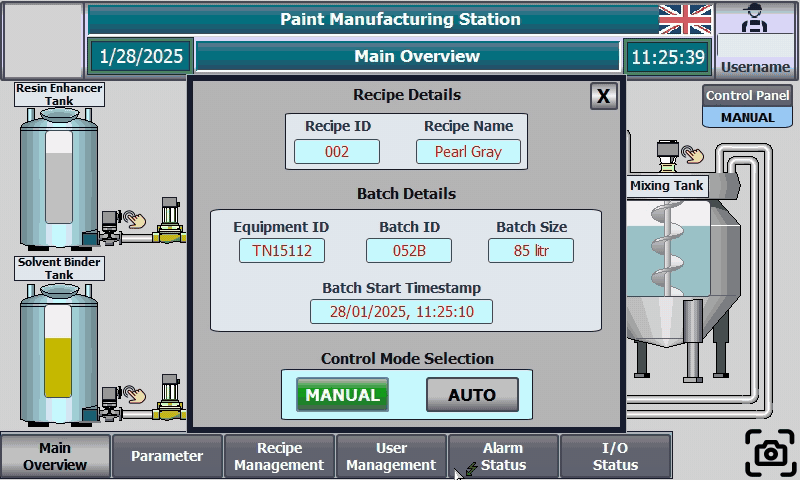
  <br>
  <sub>AUTO mode - confirm the batch, then resin, binder and pigments flow into the mixing tank.</sub>
</p>

## Project status

**Implemented use case: paint manufacturing and batch mixing.** The control modes, recipes,
alarms, diagnostics and user roles illustrate common manufacturing-station workflows; the
process graphics, tags and parameter bindings in this project are specific to the paint use case.

**Portfolio demonstrator.** This repository contains the HMI design, engineering printout,
recorded runtime evidence and reproducible documentation tooling. It is not a commissioned
plant control system or a safety-certified implementation.

The final `.zap17` is included unchanged under a neutral filename. **The archive retains its
original internal names and metadata**; only the public documentation and selected media are
anonymised. Restore and runtime compilation have not been verified in this environment.

The Python tools reproduce documentation data and charts, not the HMI runtime.

## Highlights

| Feature | What it does |
| --- | --- |
| **Live process mimic** | Five tanks, three pigment pumps with rotating impellers, an agitator and colour-coded pipe flow - 130 visibility animations on the main overview alone. |
| **MANUAL and AUTO** | Control-mode selection in the batch pop-up; in MANUAL every valve has its own ON / OFF pop-up. |
| **Recipes and batches** | WinCC recipe with 10 parameters (pigment, resin, solvent, viscosity, gloss, pH, mixing time, ...), data records stored on the panel, batch ID, size and start time per batch. |
| **Alarm overview** | 24 labelled warning/alarm tiles; five have configured tag-driven appearance changes. A reset command and a common alarm indicator demonstrate the workflow. |
| **I/O diagnostics** | Screens label 20 inputs and 20 outputs; the printout exposes 19 DI tags and 20 DO tags. See the documented mapping gaps. |
| **Role-based access** | Administrator, Operator and Engineer groups with WinCC authorizations, logon dialog, user view and the current user in the header. |
| **Bilingual runtime** | English and German texts on every screen, switched with a flag button. |
| **Process parameters** | Setpoints and actual values for flow, level, viscosity, density, temperature, pressure, mixing speed and pH. |

**Known limits:** the pigment parameter columns share setpoint tags, the I/O mapping has gaps,
and alarm acknowledgment is incomplete. See the [engineering reference](docs/hmi-reference.md).
The design models describe intended behavior; the printout and recordings show this build's scope.

## Demo

<details>
<summary><b>Watch manual control, alarms, language switching and recipes</b></summary>

| Manual valve control | Alarm handling |
| :---: | :---: |
| 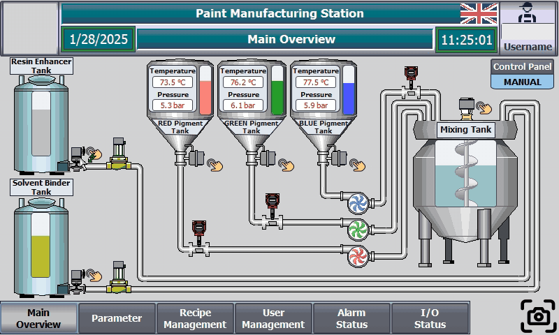 | 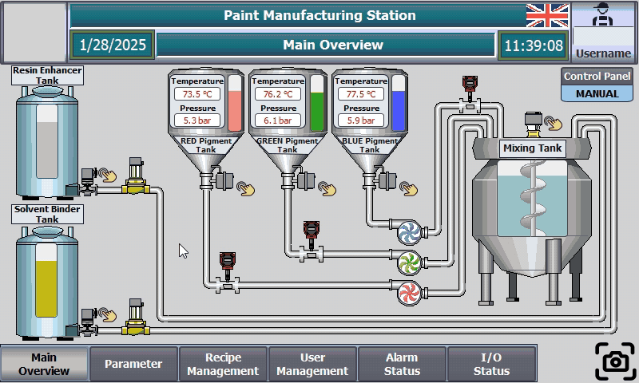 |
| **Language switch EN / DE** | **Recipe management** |
| 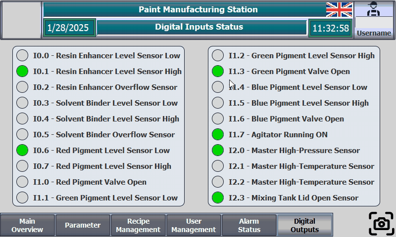 | 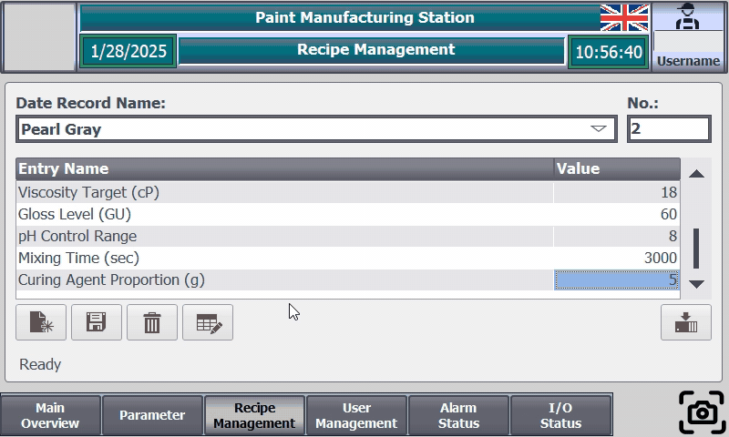 |

</details>

<p align="center">
  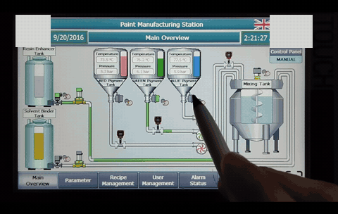
  <br>
  <sub>The same project running on a real SIMATIC TP700 Comfort panel.</sub>
</p>

The curated, silent process walkthrough (2 min 57 s) is in
[assets/video/hmi-walkthrough.mp4](assets/video/hmi-walkthrough.mp4).
Media uses visible privacy masks over account names and branding; login/account-entry and
company-introduction scenes are omitted from the video. Masks do not change process values.

<details>
<summary><b>Walkthrough chapters</b></summary>

| Time | Chapter |
| --- | --- |
| 00:00 | Main overview in MANUAL mode |
| 00:22 | Recipe management: edit, save and load records |
| 01:10 | Batch details and control-mode selection |
| 01:14 | Manual valve control |
| 01:41 | AUTO mode with animated pipe flow |
| 01:58 | Process parameters |
| 02:18 | Digital inputs and outputs, English and German |
| 02:38 | Alarm indicator and alarm status |

</details>

## Screens

| Process overview | Parameters |
| :---: | :---: |
| <a href="assets/screens/main-overview-auto.png">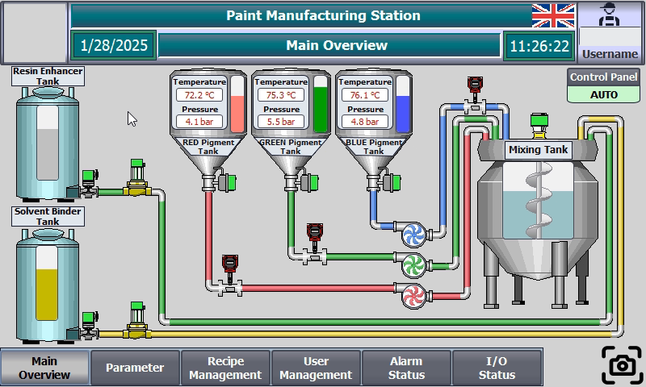</a> | <a href="assets/screens/parameters.png">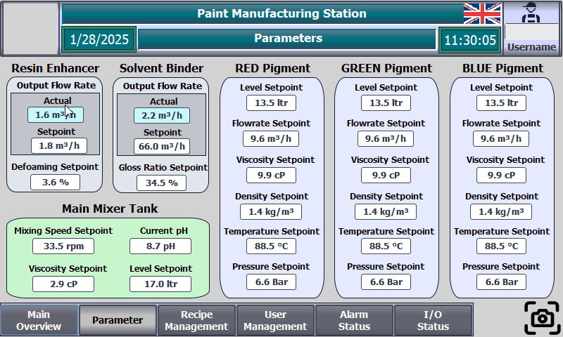</a> |
| **Alarm status** | **Recipe management** |
| <a href="assets/screens/alarm-status.png">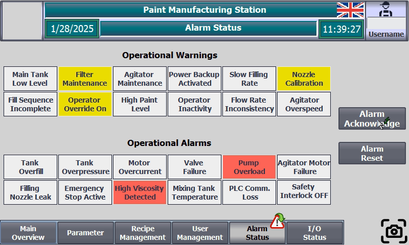</a> | <a href="assets/screens/recipe-management.png">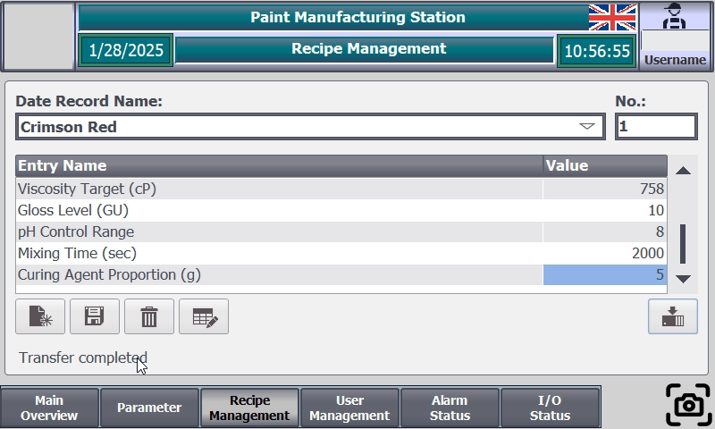</a> |

<details>
<summary><b>More screens: manual control, batch data, diagnostics and users</b></summary>

| Manual overview | Batch details |
| :---: | :---: |
| 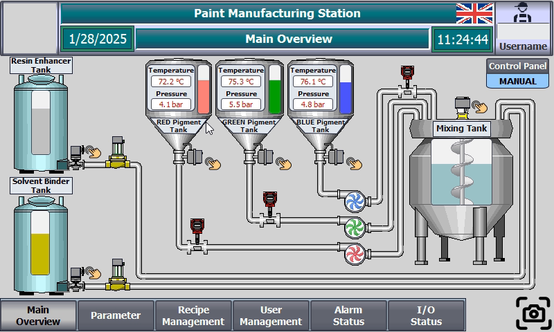 | 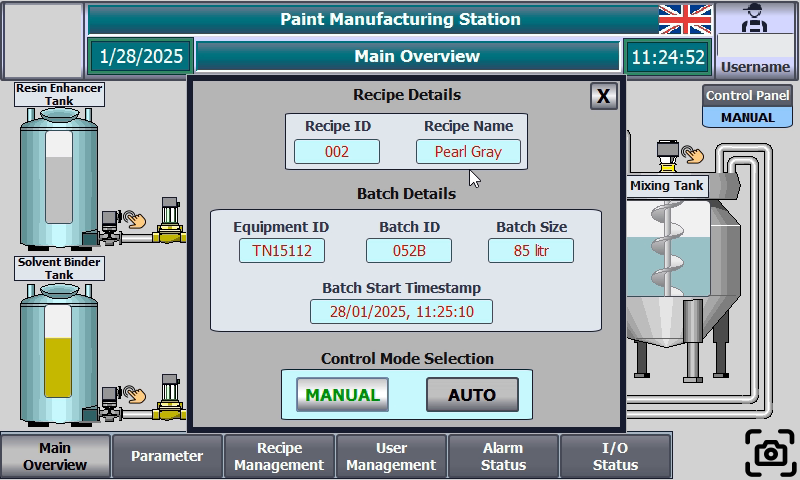 |
| **Digital inputs** | **Digital outputs (German)** |
|  | 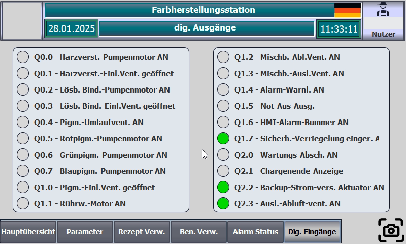 |
| **Valve control** | **User management** |
| 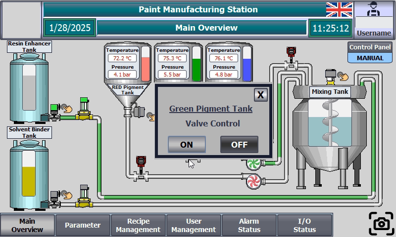 | 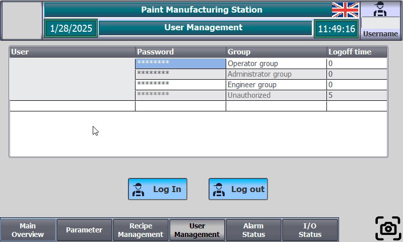 |

</details>

<sub>Runtime captures, 800 x 480 px. The four featured images link to their full-size versions.</sub>

## Architecture

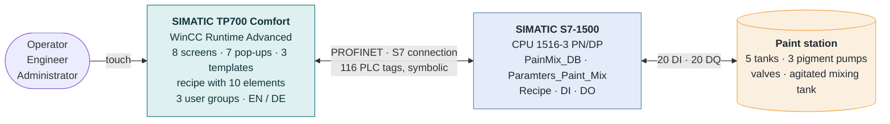

The panel (192.168.1.25) talks to the CPU (192.168.1.1) over `HMI_Connection_1`; tags are read
cyclically (1 s, 500 ms for language and agitator) through symbolic access to five PLC data sources.

## Process and I/O

<details>
<summary><b>Ingredient flow and I/O address diagram</b></summary>

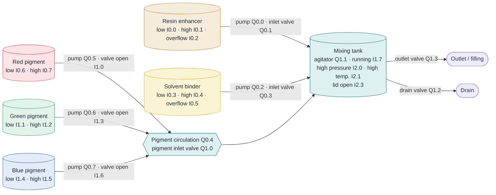

  </details>

<p align="center">
  
</p>

Safety and utility outputs (alarm light, emergency stop, buzzer, interlock, maintenance lockout,
batch-complete lamp, backup power, exhaust fan) complete the output image. Every address with its
signal name is listed in the [HMI reference](docs/hmi-reference.md#process-io).

## How it was built

The HMI was designed before it was configured: requirements became UML models, the models became a
mock-up driven by HMI usability principles, and the mock-up became the WinCC project.

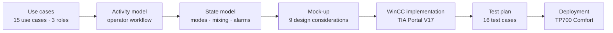

<details>
<summary><b>State model: intended operating states and transitions</b></summary>

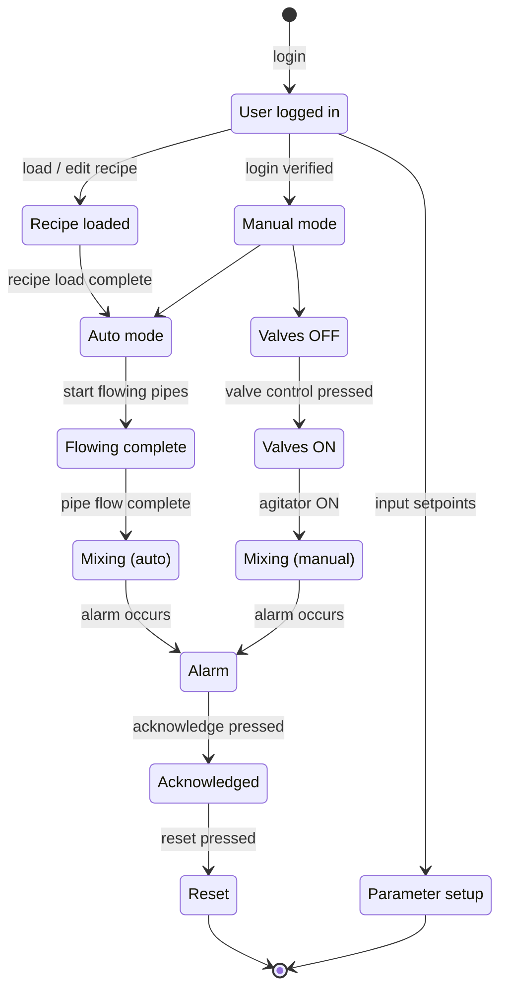

  </details>

<details>
<summary><b>Use case and activity diagrams</b></summary>
<br>

<p align="center">
  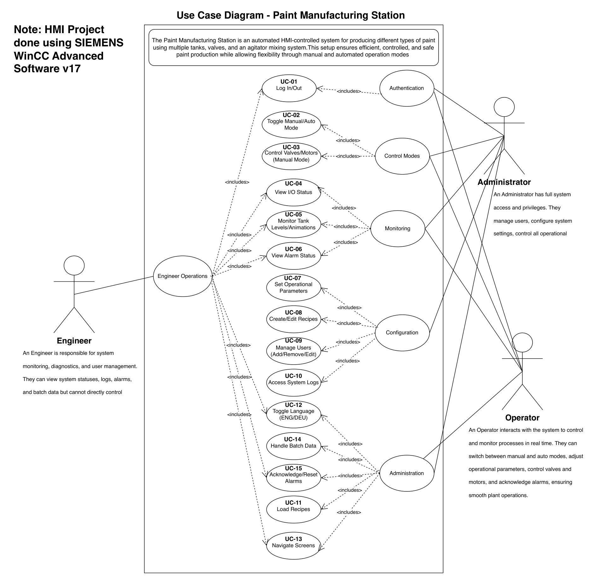
</p>
<p align="center">
  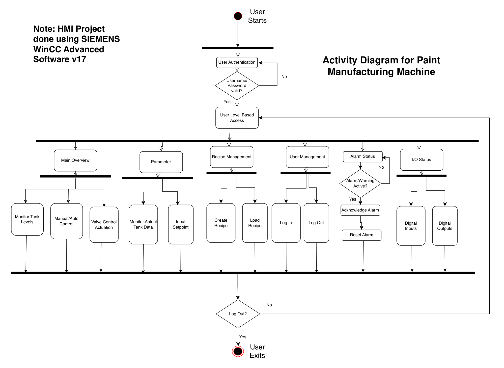
</p>

</details>

<details>
<summary><b>Usability principles behind the mock-up</b></summary>

| Principle | Where it shows up in the HMI |
| --- | --- |
| Low cognitive load | one overview with only tank levels, flows and mode; details live on their own screens |
| Pre-attentive processing | flashing yellow warnings and red alarms, warning triangle in the navigation bar |
| Distinguishable colours | ingredient colours on tanks and pipes, distinct MANUAL / AUTO indication |
| Segmented control | a fixed navigation bar from three screen templates |
| Easy recognition of widgets | rotating pump symbols on every pigment line, consistent button positions |
| Affordance | flag button for the language, pop-up buttons that read ON / OFF |
| Direct manipulation | touch a valve symbol to open its control pop-up |
| Limited states | MANUAL or AUTO only, selected in one place |
| Icon grouping with text | icon-and-label buttons such as *Log in* / *Log out* |

</details>

The complete models, the use-case-to-UI mapping and the design approach per UI element are in
[docs/design.md](docs/design.md); the original report is [docs/pdf/hmi-design-report.pdf](docs/pdf/hmi-design-report.pdf).

## By the numbers

Counted by [`tools/tia_printout.py`](tools/tia_printout.py) from the 290-page TIA Portal project documentation.
These describe the supplied printout, not a fresh extraction from the final archive; exact revision
equivalence has not been verified in TIA Portal.

| Screens | Objects | Dynamizations | System functions | HMI tags | Digital I/O | Alarm tiles | Recipe elements |
| :---: | :---: | :---: | :---: | :---: | :---: | :---: | :---: |
| **8** + 7 pop-ups | **581** | **327** | **82** | **117** | **40** | **24** | **10** |

<p align="center">
  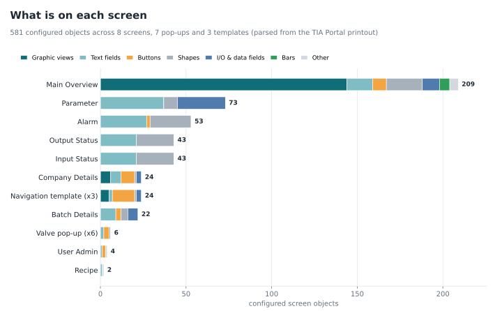
</p>
<details>
<summary><b>Animation and tag-source breakdowns</b></summary>

<p align="center">
  
</p>
<p align="center">
  
</p>

</details>

The main overview carries 209 of the 581 objects and 130 of the 136 visibility animations - the pipe
network is drawn from graphic segments that appear while an ingredient flows. Screen-level detail,
tags, I/O, alarms, recipes and user groups are documented in the [HMI reference](docs/hmi-reference.md).

## Testing

16 proposed test cases cover authentication, mode switching, valve control, I/O, tank monitoring,
alarms, parameters, recipes, language, navigation and batch data. The walkthrough illustrates
related workflows, including operation on a real TP700 Comfort panel; it is not a test execution
record and does not establish that all expected outcomes passed. See [docs/testing.md](docs/testing.md).

In this repository, [GitHub Actions](.github/workflows/ci.yml) runs `pytest` on every push: the
parser re-extracts all tables from the TIA Portal printout and compares them with [`data/`](data),
and every local link and image in the documentation is checked.

## Open the project

1. Install a licensed TIA Portal V17 engineering environment with WinCC support for the
  TP700 Comfort and the configured S7-1500 devices.
2. Download [project/wincc-simatic-manufacturing-hmi.zap17](project/wincc-simatic-manufacturing-hmi.zap17).
3. In TIA Portal, use **Project > Retrieve** to restore the archive into a separate working directory.
4. Check device support and project diagnostics, then compile the PLC and HMI before simulation.
5. Review users, credentials, network addresses and safety behavior before connecting hardware.
  Never download this demonstrator to an operating plant without an engineering review.

The archive is a byte-for-byte copy of the supplied final project. ZIP integrity and copy identity
are checked here; TIA Portal restore, compilation and runtime behavior require the vendor tools.
The internal project name may differ from the neutral archive filename.

## Repository structure

```text
wincc-simatic-manufacturing-hmi/
├── assets/
│   ├── banner.svg               animated header
│   ├── charts/                  data-driven charts (generated)
│   ├── diagrams/                UML diagrams
│   ├── gifs/                    runtime animations
│   ├── screens/                 runtime screenshots
│   └── video/                   silent walkthrough (MP4)
├── data/                        tables extracted from the TIA Portal printout
├── project/                     final native TIA Portal V17 archive
├── docs/
│   ├── design.md                UML models, design considerations, design approach
│   ├── hmi-reference.md         device, screens, I/O, alarms, recipes, users, tags
│   ├── testing.md               test plan with walkthrough timestamps
│   └── pdf/                     design report, UML diagrams, TIA Portal project documentation
├── tests/                       pytest suite
├── tools/
│   ├── tia_printout.py          TIA Portal printout -> CSV / JSON
│   └── build_charts.py          CSV / JSON -> SVG charts
└── .github/workflows/ci.yml     tests on every push
```

## Reproduce the data and charts

```bash
python -m venv .venv
source .venv/bin/activate        # Windows: .venv\Scripts\activate
pip install -r requirements.txt

python tools/tia_printout.py docs/pdf/tia-portal-project-documentation.pdf --out data
python tools/build_charts.py --data data --out assets/charts
pytest
```

`tia_printout.py` rebuilds the supplied English-language TIA Portal *project documentation* PDF
from glyph positions, font weights and sizes. It is verified against this project's export;
other layouts, languages or projects may require parser changes.

## Tech stack

| Area | Used |
| --- | --- |
| HMI engineering | SIMATIC WinCC Advanced in TIA Portal V17, WinCC Runtime Advanced simulation |
| HMI hardware | SIMATIC TP700 Comfort, 7" touch, 800 x 480 px |
| Controller | SIMATIC S7-1500, CPU 1516-3 PN/DP, PROFINET, symbolic tag access |
| WinCC features | screen templates, pop-up screens, graphic lists, recipes and recipe view, user administration, multilingual texts, scheduled tasks, system functions |
| Modelling | UML use case, activity and state diagrams |
| Tooling | Python, pypdfium2, matplotlib, pytest, GitHub Actions, Mermaid |

## License

Repository-authored tooling and documentation are released under the [MIT License](LICENSE).
Third-party product graphics and software shown in the captures retain their respective rights;
no vendor software or runtime license is included.

SIMATIC, WinCC, TIA Portal and related product names are trademarks of Siemens AG. This is an
independent project; it is not affiliated with or endorsed by Siemens.
