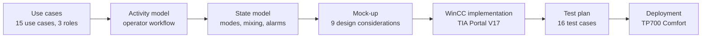
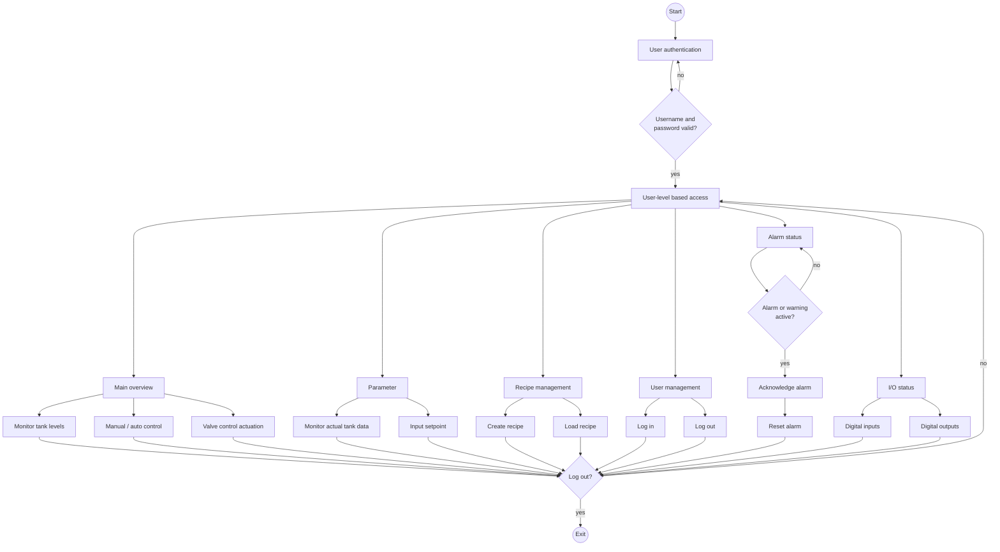
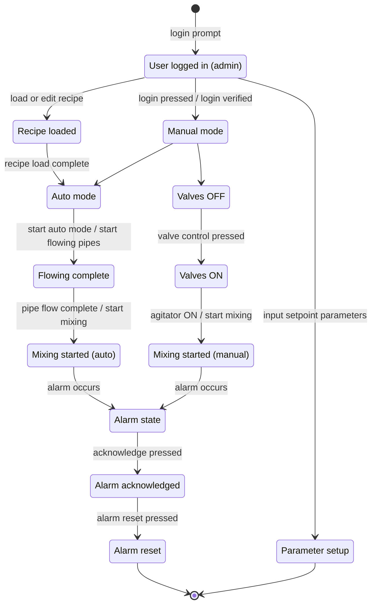

# Manufacturing Station HMI: design

The implemented industrial use case is paint manufacturing and batch mixing. The source UML
models retain their paint-station terminology to match the actual process and HMI configuration.

The HMI was designed before it was built: requirements were captured as UML models, turned into a
mock-up guided by HMI usability principles, and only then implemented in SIMATIC WinCC Advanced.
The original deliverable is [`pdf/hmi-design-report.pdf`](pdf/hmi-design-report.pdf); this page
is its readable, linkable version.

## Contents

- [Use-case model](#use-case-model)
- [Activity model](#activity-model)
- [State model](#state-model)
- [Design considerations](#design-considerations)
- [Use cases, UI elements and principles](#use-cases-ui-elements-and-principles)
- [Design approach per UI element](#design-approach-per-ui-element)

## Use-case model

The *Paint Manufacturing Station* is an HMI-controlled system that produces different paints from
several tanks, valves and an agitator. Three actors use it:

| Actor | Responsibility |
| --- | --- |
| **Operator** | controls and monitors the process in real time: switches between manual and auto mode, adjusts operational parameters, controls valves and motors and acknowledges alarms |
| **Engineer** | monitors the system and runs diagnostics: views status, logs, alarms and batch data, but does not operate the plant directly |
| **Administrator** | has full access: manages users, configures the system and can perform all operational tasks |

| ID | Use case | Realised by |
| --- | --- | --- |
| UC-01 | Log in / out | logon dialog on *User Management*, current user in the header |
| UC-02 | Toggle manual / auto mode | *Batch details* pop-up (Control Panel) |
| UC-03 | Control valves / motors (manual mode) | valve pop-ups on the main overview |
| UC-04 | View I/O status | *Digital Inputs* / *Digital Outputs* screens |
| UC-05 | Monitor tank levels / animations | main overview |
| UC-06 | View alarm status | *Alarm Status* screen, warning triangle on the navigation bar |
| UC-07 | Set operational parameters | *Parameters* screen |
| UC-08 | Create / edit recipes | recipe view on *Recipe Management* |
| UC-09 | Manage users | WinCC user view on *User Management* |
| UC-10 | Access system logs | modelled; not part of the implemented scope |
| UC-11 | Save / load recipes | recipe view: save, load, transfer to PLC |
| UC-12 | Toggle language (ENG / DEU) | flag button in the header |
| UC-13 | Navigate screens | navigation bar provided by the screen templates |
| UC-14 | Handle batch data | *Batch details* pop-up |
| UC-15 | Acknowledge / reset alarms | *Alarm Acknowledge* and *Alarm Reset* buttons |

## Activity model

How a user moves through the HMI, from authentication to logout
([original diagram](../assets/diagrams/activity-diagram.png)):

## State model

Operating states of the station and the events that move between them
([original diagram](../assets/diagrams/state-diagram.png)):

## Design considerations

| Design consideration | UI option | Use cases | Description |
| --- | --- | --- | --- |
| Low cognitive load | minimalistic dashboard with only essential controls and status indicators | UC-02, UC-04, UC-05 | Avoid clutter: show only relevant data (tank levels, alarms, I/O status) at a time; keep the manual/auto toggle prominent and easy to switch. |
| Pre-attentive processing with pop-ups | flashing alarm icon, high-contrast pop-ups for warnings and errors | UC-06, UC-15 | Critical alarms get large red indications with concise messages and reset options to grab attention instantly. |
| Distinguishable colours for similar objects | different colours for manual/auto mode and motor/valve states | UC-02, UC-03 | Manual (yellow) vs. auto (green); active motors blue, inactive grey - fast recognition of the system state. |
| Segmented control | tabs and buttons for Overview, Recipes, Parameters | UC-13, UC-07 | A navigation bar groups related actions so users switch screens without confusion. |
| Easy recognition of widgets and buttons | clear icons for start/stop/reset with consistent positions | UC-03, UC-05 | Every control has a recognisable icon, e.g. rotating pump symbols on each pigment line. |
| Affordance | toggle switches, drop-downs and buttons that look interactive | UC-02, UC-12 | The mode switch visibly changes state; the language toggle uses flags instead of text. |
| Direct manipulation | interactive tank graphics and motor/valve symbols | UC-05, UC-03 | Operate valves and motors by touching their graphical representation. |
| Limited states | clearly defined states (stopped, running, maintenance, alarm) with a dedicated display | UC-02, UC-06 | Only valid states are shown; *manual* is entered only through the Control Panel. |
| Icon grouping with text | icons with labels, e.g. *Save recipe* with a disk icon | UC-08, UC-11 | Icon plus text makes the function of a button obvious. |

## Use cases, UI elements and principles

| Use case | UI element | Design considerations |
| --- | --- | --- |
| UC-01 Log in / out | login screen | colour combinations, recognition of response after input, simple interaction options |
| UC-02 Toggle manual / auto mode | mode toggle button | easy recognition of widgets, limited states, affordance |
| UC-03 Control valves / motors (manual) | valve / motor control panel | direct manipulation, time required for response, recognition of response after input |
| UC-04 View I/O status | I/O status display | colour combinations, low cognitive load, coordination of content |
| UC-05 Monitor tank levels / animations | tank level graphics | perception and evaluation, shape of sub-objects, similarity and continuity |
| UC-06 View alarm status | alarm pop-up and acknowledgment | pre-attentive processing, reflexive processes, recognition of response after input |
| UC-07 Set operational parameters (flow rate, viscosity, ...) | parameter input fields | simple interaction options, shape of sub-objects, recognition of response after input |
| UC-08 Create / edit recipes (e.g. "Emerald Green") | recipe management screen | segmented control, coordination of content, affordance |
| UC-09 Manage users | user management panel | icon grouping, recognition of response after input, simple interaction options |
| UC-11 Save / load recipes | save / load recipe interface | lower complexity, recognition of response after input, simple interaction options |
| UC-12 Toggle language (ENG / DEU) | language toggle button | easy recognition of widgets, affordance, perception and evaluation |
| UC-13 Navigate screens | navigation menu | direct manipulation, segmented control, lower complexity |
| UC-14 Handle batch data (recipe ID, batch size, timestamp) | batch data form | shape of sub-objects, simple interaction options, recognition of response after input |
| UC-15 Acknowledge / reset alarms | alarm reset button | reflexive processes, recognition of response after input, time required for response |

## Design approach per UI element

| UI element | Affordance | Design considerations applied |
| --- | --- | --- |
| **Alarm pop-up** (UC-06, UC-15) | clearly signals an urgent issue that needs action | *pre-attentive processing* - red exclamation icon; *recognition of response after input* - confirmation after acknowledge/reset; *reflexive processes* - reset removes the message directly |
| **Manual / auto toggle** (UC-02) | shows that the user can switch between two modes | *limited states* - only "manual" or "auto"; *segmented control* - placed in a logical section; *easy recognition* - distinct shape and colour |
| **Tank level display** (UC-05) | levels readable without reading numbers | *similarity and continuity* - animation follows real-time data; *colour combinations* - contrasting colours for safe and critical levels; *perception and evaluation* - too high / too low is obvious |
| **Recipe selection** (UC-08, UC-11) | a drop-down picks a recipe instead of typing it | *simple interaction* - select instead of type; *coordination of content* - menu next to the recipe settings; *lower complexity* - only relevant options |
| **Navigation menu** (UC-13) | screens are one touch away | *icon grouping with text*; *direct manipulation* - a tab changes the screen immediately; *shape of sub-objects* - clearly structured menu |
| **Language toggle** (UC-12) | a single button switches English / German | *easy recognition* - country flags instead of text; *affordance*; *perception and evaluation* - all texts update immediately |
| **Valve / motor control** (UC-03) | buttons and indicators show how to operate valves and motors | *direct manipulation* - start/stop and open/close by touch; *time required for response* - instant status update; *recognition of response* - green ON, red OFF |
| **User authentication** (UC-01) | clearly shows where to enter credentials | *colour combinations* - high-contrast fields; *recognition of response* - error message on a wrong password; *simple interaction* - hidden password input with a show-password toggle |
