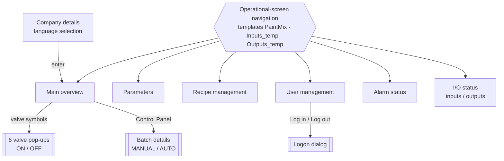
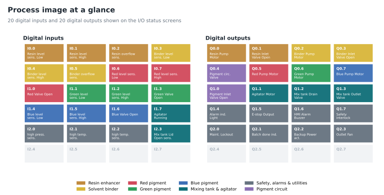
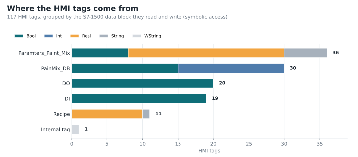
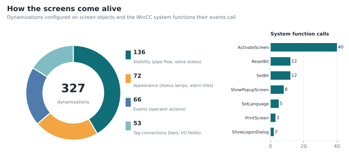

# Manufacturing Station HMI: engineering reference

Engineering facts for the paint-manufacturing use case, taken from the TIA Portal project documentation
([`docs/pdf/tia-portal-project-documentation.pdf`](pdf/tia-portal-project-documentation.pdf), 290 pages).
The tables in [`data/`](../data) are extracted from that PDF by [`tools/tia_printout.py`](../tools/tia_printout.py),
so every number below can be regenerated.

## Contents

- [Device and runtime](#device-and-runtime)
- [Connection to the PLC](#connection-to-the-plc)
- [Screens](#screens)
- [Navigation](#navigation)
- [Process I/O](#process-io)
- [Alarm and warning tiles](#alarm-and-warning-tiles)
- [Parameters](#parameters)
- [Recipes](#recipes)
- [Users and authorizations](#users-and-authorizations)
- [HMI tags](#hmi-tags)
- [Animations and graphic lists](#animations-and-graphic-lists)
- [Data files](#data-files)

## Device and runtime

| Setting | Value |
| --- | --- |
| HMI device | SIMATIC TP700 Comfort (7" widescreen touch panel) |
| Runtime | WinCC Runtime Advanced, TIA Portal V17 |
| Resolution / colour depth | 800 x 480 px, 32 bit |
| Style | WinCC Dark V 1.0.1 |
| Runtime languages | English (United States), German (Germany) |
| Start screen (configured) | `Input_Status` |
| Screen keyboard | enabled |
| Logon | max. 3 invalid attempts, minimum password length 3 |
| Scheduled task | on user change: `GetUserName` writes the current user to `UserName_fromHMI` (shown in the header) |

## Connection to the PLC

| Setting | Value |
| --- | --- |
| Connection | `HMI_Connection_1`, driver *SIMATIC S7 1500*, online |
| Partner | `PLC_1` in station `S7-1500/ET200MP-Station_1` |
| Node | CPU 1516-3 PN/DP, PROFINET interface |
| HMI address | 192.168.1.25 (Ethernet, access point S7ONLINE) |
| PLC address | 192.168.1.1 |
| Tag access | symbolic, cyclic in operation, 1 s acquisition (500 ms for language and agitator tags) |

## Screens

| Screen | Kind | Template | Objects | Visibility | Appearance | Tag connections | Events |
| --- | --- | --- | ---: | ---: | ---: | ---: | ---: |
| `MainOverview` | screen | `PaintMix` | 209 | 130 | 11 | 16 | 8 |
| `Parameter` | screen | `PaintMix` | 73 | 0 | 0 | 28 | 0 |
| `Alarm` | screen | `PaintMix` | 53 | 0 | 5 | 0 | 2 |
| `Input_Status` | screen | `Inputs_temp` | 43 | 0 | 20 | 0 | 0 |
| `Output_Status` | screen | `Outputs_temp` | 43 | 0 | 19 | 0 | 0 |
| `Company_Details` | screen | - | 24 | 0 | 0 | 0 | 3 |
| `User_Admin` | screen | `PaintMix` | 4 | 0 | 0 | 0 | 2 |
| `Recipe` | screen | `PaintMix` | 2 | 0 | 0 | 0 | 0 |
| `BatchDetails` | pop-up | - | 22 | 0 | 2 | 6 | 3 |
| 6 valve pop-ups | pop-up | - | 6 each | 0 | 2 each | 0 | 3 each |
| `PaintMix`, `Inputs_temp`, `Outputs_temp` | template | - | 24 each | 2 each | 1 each | 1 each | 10 each |

Four slide-in screens and the global screen exist in the project but are empty.
The full object list (581 objects with type, position, animations, functions and captions) is in
[`data/screen_objects.csv`](../data/screen_objects.csv).

## Navigation

The seven operational screens inherit a navigation bar from their templates; the welcome
screen has its own controls. `PaintMix` links to
*Main Overview, Parameter, Recipe Management, User Management, Alarm Status* and *I/O Status*;
the two I/O templates swap the last button between *Digital Inputs* and *Digital Outputs*.
The header carries date and time, the current user and a flag button that toggles EN/DE
(`SetLanguage`); a camera button next to the navigation bar prints the screen (`PrintScreen`).

Pop-ups return to the main overview when a button is pressed.

All 48 screen changes and pop-up calls are listed in [`data/navigation.csv`](../data/navigation.csv).

## Process I/O

| Input | Signal | Output | Signal |
| --- | --- | --- | --- |
| I0.0 | Resin Enhancer Level Sensor Low | Q0.0 | Resin Enhancer Pump Motor ON |
| I0.1 | Resin Enhancer Level Sensor High | Q0.1 | Resin Enhancer Inlet Valve Open |
| I0.2 | Resin Enhancer Overflow Sensor | Q0.2 | Solvent Binder Pump Motor ON |
| I0.3 | Solvent Binder Level Sensor Low | Q0.3 | Solvent Binder Inlet Valve Open |
| I0.4 | Solvent Binder Level Sensor High | Q0.4 | Pigment Circulation Valve ON |
| I0.5 | Solvent Binder Overflow Sensor | Q0.5 | Red Pigment Pump Motor ON |
| I0.6 | Red Pigment Level Sensor Low | Q0.6 | Green Pigment Pump Motor ON |
| I0.7 | Red Pigment Level Sensor High | Q0.7 | Blue Pigment Pump Motor ON |
| I1.0 | Red Pigment Valve Open | Q1.0 | Pigment Inlet Valve Open |
| I1.1 | Green Pigment Level Sensor Low | Q1.1 | Agitator Motor ON |
| I1.2 | Green Pigment Level Sensor High | Q1.2 | Mixing Tank Drain Valve ON |
| I1.3 | Green Pigment Valve Open | Q1.3 | Mixing Tank Outlet Valve ON |
| I1.4 | Blue Pigment Level Sensor Low | Q1.4 | Alarm Indicator Light ON |
| I1.5 | Blue Pigment Level Sensor High | Q1.5 | Emergency Stop Output |
| I1.6 | Blue Pigment Valve Open | Q1.6 | HMI Alarm Buzzer ON |
| I1.7 | Agitator Running ON | Q1.7 | Safety Interlock Engaged ON |
| I2.0 | Master High-Pressure Sensor | Q2.0 | Maintenance Lockout ON |
| I2.1 | Master High-Temperature Sensor | Q2.1 | Batch Complete Indicator |
| I2.2 | Master High-Temperature Sensor | Q2.2 | Backup Power Actuator ON |
| I2.3 | Mixing Tank Lid Open Sensor | Q2.3 | Outlet Exhaust Fan ON |

The screens label 20 inputs and 20 outputs, but labels alone do not prove working diagnostics.
`DI_I0.3` is absent from the tag inventory, the output screen has only 19 appearance bindings,
and I2.1/I2.2 share the same temperature-sensor caption. These mappings need verification in
TIA Portal before use. Source: [`data/io_map.csv`](../data/io_map.csv).

## Alarm and warning tiles

The *Alarm Status* screen groups 24 tiles in two blocks. Tiles wired to PLC bits flash
yellow (warning) or red (alarm); *Alarm Acknowledge* and *Alarm Reset* buttons sit next to the
blocks, and a warning triangle on the *Alarm Status* navigation button signals pending events.

| Operational warnings | Operational alarms |
| --- | --- |
| Main Tank Low Level | Tank Overfill |
| Filter Maintenance | Tank Overpressure |
| Agitator Maintenance | Motor Overcurrent |
| Power Backup Activated | Valve Failure |
| Slow Filling Rate | Pump Overload |
| Nozzle Calibration | Agitator Motor Failure |
| Fill Sequence Incomplete | Filling Nozzle Leak |
| Operator Override On | Emergency Stop Active |
| High Paint Level | High Viscosity Detected |
| Operator Inactivity | Mixing Tank Temperature |
| Flow Rate Inconsistency | PLC Comm. Loss |
| Agitator Overspeed | Safety Interlock OFF |

In this build five tiles are connected to PLC tags (`Warning_1..3`, `Alarm_1..2` in
`Paramters_Paint_Mix`) plus a common alarm/warning bit; the WinCC alarm system itself
(discrete/analog alarms, alarm logs) is not used. Source: [`data/alarm_indicators.csv`](../data/alarm_indicators.csv).

The printout lists no event function for the *Alarm Acknowledge* button. The *Alarm Reset*
button pulses `PainMix_DB_Alarm_ACK` through `SetBit` / `ResetBit`. This is a partial
demonstration, not a complete alarm acknowledgment implementation.

## Parameters

| Area | Values |
| --- | --- |
| Resin enhancer | output flow rate (actual / setpoint), defoaming setpoint |
| Solvent binder | output flow rate (actual / setpoint), gloss ratio setpoint |
| Red, green and blue pigment | level, flow rate, viscosity, density, temperature and pressure setpoints |
| Main mixer tank | mixing speed setpoint, current pH, viscosity setpoint, level setpoint |

Actual tank temperatures and pressures of the three pigment tanks are shown on the main overview.

**Shared setpoints:** all three pigment columns bind to the same six `_R` tags. They do not
provide independent red/green/blue tuning in the supplied printout. Correct those bindings in
TIA Portal if separate pigment setpoints are required; the archived project is left unchanged.

## Recipes

`Recipe_1` stores up to 500 data records as files on the panel (`\Flash\Recipes`), exchanges values
with the PLC through recipe tags (teach-in mode, tag synchronisation and limit checks enabled) and is
operated through a recipe view on the *Recipe Management* screen.

| # | Element | Unit | Crimson Red (record 1) | Pearl Gray (record 2) |
| ---: | --- | --- | ---: | ---: |
| 1 | Pigment Concentration | % | 30 | 50 |
| 2 | Resin Ratio | % | 32 | 30 |
| 3 | Solvent Composition | mL | 260 | 75 |
| 4 | Additive Ratios | % | 1 | 2 |
| 5 | Drying Agent Ratio | % | 3 | 3 |
| 6 | Viscosity Target | cP | 758 | 18 |
| 7 | Gloss Level | GU | 10 | 60 |
| 8 | pH Control Range | - | 8 | 8 |
| 9 | Mixing Time | s | 2000 | 3000 |
| 10 | Curing Agent Proportion | g | 5 | 5 |

The element definitions come from the printout ([`data/recipe_elements.csv`](../data/recipe_elements.csv));
the two data records were created at runtime and are shown in the walkthrough video.
The *Batch details* pop-up shows recipe ID and name, equipment ID, batch ID, batch size and the batch
start timestamp next to the MANUAL / AUTO selection.

## Users and authorizations

| Group | Authorizations | Typical use |
| --- | --- | --- |
| Administrator group | User administration, Operate, Monitor | full access, manages users |
| Operator group | Operate, Monitor | runs the process: modes, valves, parameters, recipes, alarms |
| Engineer group | Monitor | supervises status, I/O, alarms and batch data without operating |

One demo user exists per group. Users log on through the logon dialog on the *User Management*
screen, which also hosts the WinCC user view. Source: [`data/user_groups.csv`](../data/user_groups.csv).
The table describes configured group rights, not an access-control test. Verify authorization
on each actionable object and replace demo credentials before any real deployment.

## HMI tags

| PLC source | Tags | Content |
| --- | ---: | --- |
| `Paramters_Paint_Mix` | 36 | setpoints and actual values, batch data, warning and alarm bits, language |
| `PainMix_DB` | 30 | valve commands and states, pipe-flow states, pump rotors, tank levels, alarm acknowledge |
| `DO` | 20 | digital outputs Q0.0 to Q2.3 |
| `DI` | 19 | digital inputs I0.0 to I2.3 (I0.3 has no HMI tag) |
| `Recipe` | 11 | recipe elements and recipe name |
| internal | 1 | `UserName_fromHMI` |

Data types: 62 Bool, 32 Real, 15 Int, 7 String, 1 WString. Full list with PLC tag and acquisition
cycle: [`data/hmi_tags.csv`](../data/hmi_tags.csv). Data-block and tag names are kept exactly as
configured in the project.

## Animations and graphic lists

- **Pipe flow** - 130 visibility animations on the main overview reveal coloured pipe segments
  while an ingredient flows.
- **Pumps and agitator** - graphic I/O fields cycle through graphic lists
  (`Pump_Fan_Red/Green/Blue`: 4 frames each, `Agitator`: 3 states) to show rotation.
- **Levels** - six bar graphs show tank levels; I/O fields show temperatures and pressures.
- **Status lamps and tiles** - appearance animations colour the I/O lamps and flash the alarm tiles.

## Data files

| File | Rows | Content |
| --- | ---: | --- |
| [`summary.json`](../data/summary.json) | - | device, connection and all headline counts |
| [`screens.csv`](../data/screens.csv) | 24 | screens, pop-ups, templates with object, animation and function counts |
| [`screen_objects.csv`](../data/screen_objects.csv) | 581 | every screen object with type, position, animations, functions, caption |
| [`navigation.csv`](../data/navigation.csv) | 48 | screen changes and pop-up calls per event |
| [`hmi_tags.csv`](../data/hmi_tags.csv) | 117 | HMI tags with data type, connection, PLC tag, acquisition cycle |
| [`io_map.csv`](../data/io_map.csv) | 40 | digital inputs and outputs |
| [`alarm_indicators.csv`](../data/alarm_indicators.csv) | 24 | alarm and warning tiles |
| [`recipe_elements.csv`](../data/recipe_elements.csv) | 10 | recipe elements and their tags |
| [`user_groups.csv`](../data/user_groups.csv) | 3 | user groups and authorizations |
